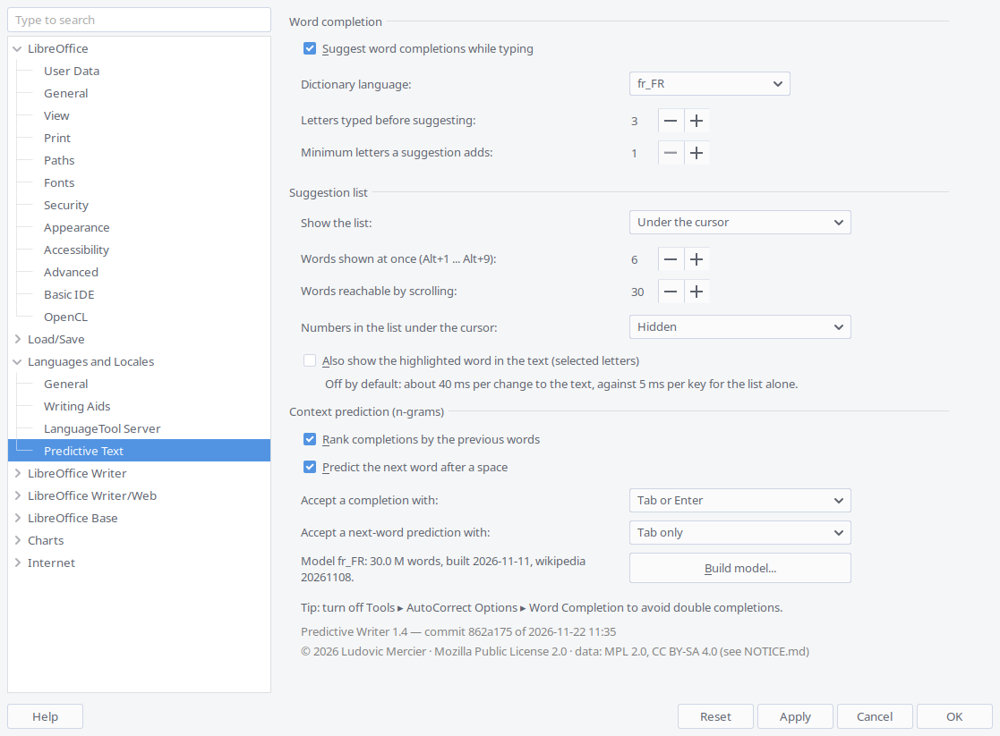
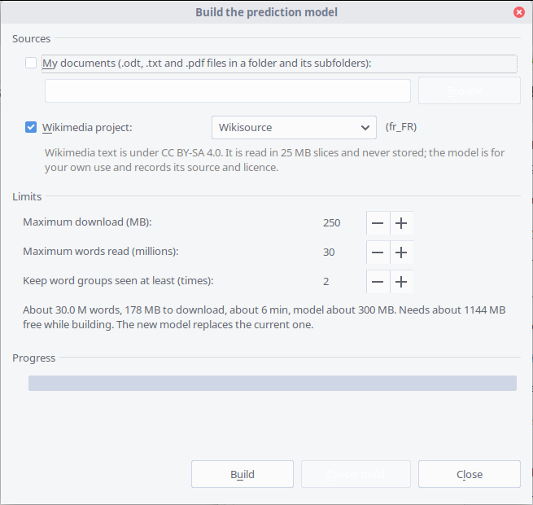

# Predictive Writer

Predictive word completion for LibreOffice Writer, backed by Hunspell dictionaries.
To build it, see [Build](#build); to install it, see [Installation](#installation).


Writing a paragraph by Alfred Fouillée:

https://github.com/user-attachments/assets/17393ab1-89ff-4e9f-a36e-0bbe7c725017

*Text: extract of Alfred Fouillée, « L’Influence et l’avenir des idées cartésiennes »,
published in the* Revue des Deux Mondes *in 1893 (public domain;
[Wikisource](https://fr.wikisource.org/wiki/L%E2%80%99Influence_et_l%27avenir_des_id%C3%A9es_cart%C3%A9siennes)).
Typed with context prediction on (Wikipedia model): 898 characters in 658 keystrokes,
27% fewer.*

## Status: suggestion list + context prediction + French grammar + model builder

While you type, a list of the most likely words appears under the cursor:
6 at a time, and you can scroll through up to 30 (both adjustable). Optionally, the
highlighted word is also shown in the text as selected letters: `prédi[re]` (off by
default, see below).

```
La prédi|
   prédire       ← highlighted
   prédiction
   prédicat
   …
     1–6 / 30    ← shown when there are more words than fit
```

The list uses the document's font at the current zoom and starts exactly under the
typed word, so the typed letters and the suggestions line up column by column. Numbers
(for Alt+1 … Alt+9) can be shown in a grey column left of the words (see Settings).

| Key | Effect while suggestions are shown |
| --- | --- |
| Tab / Enter | accept the highlighted word (the cursor jumps after it); configurable, see Settings |
| ↑ / ↓ | move the highlight; past the last visible word the list scrolls (wraps around at the end) |
| Page Up / Page Down | move one page (stops at the first / last word) |
| Alt+1 … Alt+9 | pick the 1st … 9th word of the visible part of the list (numbers shown or not, see Settings) |
| click on a word | pick it |
| Esc | close the list (and remove the selected letters) |
| Backspace / Delete | close the list; with letters shown in the text, remove only them |
| any other key | closes the list, then works normally |

When no suggestion is shown, all keys (Tab in tables, Enter, arrows...) behave as usual.
Clicking elsewhere or saving also closes the list. Rejected suggestions leave no trace in
the Undo list; an accepted one is its own Undo step.

The list can also be a bar at the bottom or top of the text area (see Settings).

- Suggestions start after 3 letters (adjustable) and are ranked by how common the word
  is in everyday French (film subtitles): `com` → comme, comment, combien.
- **Verbs agree with the subject**: `nous mang` → mangeons, `tu mang` → manges,
  `j'ai mang` / `elle est arriv` → past participle (mangé, arrivée), `il faut mang` /
  `je vais fai` → infinitive. Object pronouns and *ne*/*pas* in between are skipped
  (`je ne l'ai pas mang` → mangé). Noun subjects (`les enfants mang`) are not handled.
- **Right after an apostrophe**, suggestions appear at once and only offer words that
  may follow it: `j'` → j'ai, j'étais, j'avais; `qu'` → qu'il, qu'elle; `je l'` →
  l'ai, l'aime (never `l'arbres` or `l'chat`).
- The apostrophe style (`'` or `’`) and capitals (`J’`, `L’`) follow your text.
- Turn it on or off in **Tools → Options → Languages and Locales → Predictive Text**.

### Before using

Turn off Writer's built-in Word Completion (**Tools → AutoCorrect Options → Word
Completion → Enable word completion**), otherwise both complete at once.

### Settings

**Tools → Options → Languages and Locales → Predictive Text**:



The bottom of the page shows the version and the git commit the extension was built from.

| Setting | Default |
| --- | --- |
| Suggest word completions while typing | on |
| Dictionary language (`fr_FR`, `en_US`) | `fr_FR` |
| Letters typed before suggesting | 3 |
| Minimum letters a suggestion adds | 1 (so `je mang` offers *mange*) |
| Show the list: under the cursor, bar at the bottom, bar at the top, don't show | under the cursor |
| Words shown at once (1–9) | 6 |
| Words reachable by scrolling (1–100) | 30 |
| Numbers in the list under the cursor: hidden, left of the words | hidden |
| Also show the highlighted word in the text (selected letters) | off (slower, see below) |
| Rank completions by the previous words (n-gram model) | off |
| Predict the next word after a space (n-gram model) | off |
| Accept a completion with: Tab or Enter, Tab only, Enter only | Tab or Enter |
| Accept a next-word prediction with: same choices | Tab only (Enter keeps making a new paragraph) |

The **Build model…** button, next to the model line, builds the n-gram model (see below).

Changes apply as soon as you press OK or Apply, without restarting. Automatic
language detection from the text comes in the futur.

The settings are stored in `~/.config/libreoffice/4/user/predictive-writer/settings.json`.
If you edit that file by hand, restart LibreOffice.

**Troubleshooting log:** `"debug": true` in `settings.json` (not on the Options page) logs
every keystroke and suggestion to `log.txt` in the same folder. The log then contains what
you type; it never leaves your machine. Set it back to `false` when you are done.

### Context prediction (n-grams)

With an n-gram model, suggestions take the previous words into account:
`la seconde guerre mon` → *mondiale*, `les états u` → *unis*, and after a space the
list offers the next word: `il a été ` → *réalisé, découvert, créé…*,
`la ville de ` → *Paris, Toulouse…* It uses [pressagio](https://github.com/Poio-NLP/pressagio)
(vendored, Apache-2.0), runs in a background thread, and the dictionary list is shown
first and replaced when the context predictions arrive.

The model is not shipped with the extension: build it once on your machine with the
**Build model…** button of the Options page.



| Choice | Default | |
| --- | --- | --- |
| **My documents** | off | every `.odt`, `.txt` and `.pdf` file of a folder and its subfolders (PDF: see below) |
| **Wikimedia project** | on, Wikisource | Wikisource, Wikipedia, Wikinews or Wikiquote in the model's language |
| Maximum download (MB) | 250 | for the Wikimedia project |
| Maximum words read (millions) | 30 | your documents are read first |
| Keep word groups seen at least (times) | 2 | rarer groups are dropped, which keeps the model small |

Before you start, the dialog estimates the words, the download, the time, the model size and
the free disk space needed. While it builds, a progress bar shows the download and the words
read. **Cancel build** keeps the current model; **Close** lets the build go on in the
background (the Options page shows *Building a new model…*). Once finished, the new model
**replaces** the current one and is used at once, without restarting LibreOffice. The
dialog remembers your choices.

Some builds in French, measured:

| Source | Download | Words | Time | Model |
| --- | --- | --- | --- | --- |
| Wikipedia, 250 MB limit | ~236 MB | 30 million | ~5 min | 314 MB |
| Wikisource, 2 MB limit | 2 MB | 336,000 | 7 s | a few MB |
| 4 PDF guides (22 MB, 220 pages) | none | 65,000 | 1 s | 1 MB |

How it works:

- **Wikimedia text** comes from the official
  [CirrusSearch dumps](https://dumps.wikimedia.org/other/cirrus_search_index/) over HTTPS,
  in 25 MB slices with a 2 s pause between them. Nothing is stored except the model.
- **PDF files** are read with `pdftotext`, and counted for the estimate with `pdfinfo`.
  Both come with poppler-utils (`sudo apt install poppler-utils`; already installed on
  most Linux desktops). Without them, PDF files are skipped and the dialog says so before
  the build. A damaged or protected file is skipped too, and listed in `log.txt`.
- **The build runs in a separate Python process** at low priority, so typing in Writer
  stays smooth. On Linux this is the system's `python3`; on Windows and macOS, the Python
  that ships with LibreOffice (untested).

Without LibreOffice, the same build runs from the command line:

```bash
python3 tools/train_ngrams.py --wikisource                      # 250 MB at most
python3 tools/train_ngrams.py --wikipedia --max-download-mb 100
python3 tools/train_ngrams.py --folder ~/Documents --wikisource
python3 tools/train_ngrams.py --help                            # all the options
```

It writes `~/.config/libreoffice/4/user/predictive-writer/ngrams_fr_FR.sqlite` (`--out`
for another path); restart LibreOffice to use a model built this way. Then tick the
context options in the Options page.

**Licence of a Wikimedia model:** Wikimedia text is CC BY-SA 4.0 (and GFDL). A model built
from it is for your own use; if you share it, keep it under CC BY-SA 4.0 with the
attribution recorded in its `_meta` table (source, dump date, licence).

### Known limitations

- **Speed of the letters shown in the text:** LibreOffice needs 15–60 ms for each change
  the extension makes to the text, so showing the highlighted word in the text adds
  about 40 ms when it appears and 20 ms when it goes, and ↑/↓ cost about 40 ms each.
  The list alone costs about 5 ms per key. That is why "Also show the highlighted word
  in the text" is off by default.
- **Scrolling the list is keyboard only:** LibreOffice's window API has no
  mouse-wheel event for the list.
- **The list does not follow scrolling:** if you scroll with the mouse wheel while the
  list is open, it stays where it was until the next key.
- **The list uses LibreOffice's accessibility interface** to find the cursor on screen
  (the text API does not expose it). It is clipped to the document area.
- **Startup:** the French list (450k word forms with their grammar data) loads in the
  background in about 4–6 s and uses about 26 MB of memory. There are no suggestions
  until it has loaded.
- **Verb agreement** relies on subject pronouns, avoir/être and a list of modal verbs
  and prepositions; noun subjects (`les enfants mang`) are not handled. Rare dialectal
  forms (`mangeotter`) may appear at the end of a list.
- **Dead keys / IME:** a character composed with a dead key (`^` + `e`) may not trigger
  a suggestion until the next key.
- **A new model replaces the old one:** new documents cannot be added to an existing
  model; build it again with all its sources. The estimate is a rough guide, especially
  for PDF files (counted at 300 words per page).

## Build

Building the extension only needs **Python 3.8+** (and `git`, for the build
information); LibreOffice is not needed. The word lists in `extension/data/` are
already generated and committed.

```bash
python3 tools/build_oxt.py                     # -> dist/predictive-writer-<version>.oxt
```

To try a build on your own machine (see [Installation](#installation)):

```bash
unopkg add -f dist/predictive-writer-1.3.oxt   # close LibreOffice first
soffice --writer                               # start from a terminal to see errors
```

### Version

**The git tag is the version.** `build_oxt.py` takes the last tag `v<major>.<minor>`
reachable from the current commit (`git describe`) and writes that version into the
`.oxt` (in its `description.xml`, shown by LibreOffice, and in `buildinfo.json`). To
release a new version, just tag it — no file to edit:

```bash
git tag v1.3
git push origin v1.3      # also publishes the GitHub release, see below
```

Between two tags, builds keep the last tag's version (LibreOffice versions are
numbers only) and the bottom of the Options page shows how far from the tag they are,
e.g. *Predictive Writer 1.3 (+3 commits) — commit abc1234 of 2026-11-20 09:00*, with
*(with uncommitted changes)* if the working tree was modified. Installing a newer `.oxt`
with `unopkg add -f` replaces the old one.

Without git or without a `v*` tag (e.g. building from a source archive), the version
written in `extension/description.xml` and `predictive/__init__.py` (`__version__`) is
used as a fallback; these two must agree (checked by `build_oxt.py` and the tests).

### Automatic build on GitHub

The workflow [.github/workflows/build.yml](.github/workflows/build.yml) runs on every
push and pull request: the tests, lint (`black`, `pyflakes`), then the build. The `.oxt`
can be downloaded from the run's page (**Actions** tab, *Artifacts*).

The tests run on every Python that executes the extension for some users. On Linux,
LibreOffice uses the system's Python; on Windows and macOS it ships its own:

| Runner | Python | Users it stands for |
| --- | --- | --- |
| `ubuntu-24.04` | 3.8 | LibreOffice 7.4 – 24.2 on Windows / macOS |
| `ubuntu-24.04` | 3.9 | LibreOffice 24.8 on Windows / macOS |
| `ubuntu-22.04` | 3.10 | Ubuntu 22.04 (LibreOffice 7.3) |
| `ubuntu-latest` | 3.11 | Debian 12 bookworm (LibreOffice 7.4) |
| `ubuntu-latest` | 3.12 | Ubuntu 24.04 (LibreOffice 24.2) |
| `ubuntu-latest` | 3.13 | Debian 13 trixie (LibreOffice 25.2) |
| `windows-latest` | 3.10 | Windows, LibreOffice 25.2 |
| `windows-latest` | 3.12 | Windows, LibreOffice 26.2 |

Python versions taken from LibreOffice's `download.lst` (bundled Python) and from
packages.debian.org / packages.ubuntu.com (November 2026). The runners are listed in
[actions/runner-images](https://github.com/actions/runner-images); `ubuntu-latest` is
Ubuntu 26.04, where `actions/setup-python` no longer provides Python 3.8 and 3.9, hence
`ubuntu-24.04` for those two.

To publish a release, push a version tag; the workflow builds the `.oxt` with that
version (it fetches the whole history and tags) and creates a GitHub Release with the
`.oxt` attached. It refuses if the pushed tag is not the version tag of its commit.

### Word lists

Only needed to regenerate `extension/data/`:

```bash
python3 tools/build_wordlist.py --lang en_US
python3 tools/build_wordlist.py --lang fr_FR \
    --freq sources/frequencywords/fr_full.txt \
    --elision-model ~/.config/libreoffice/4/user/predictive-writer/ngrams_fr_FR.sqlite
```

`tools/build_wordlist.py` expands `/usr/share/hunspell/<lang>.dic/.aff` into all word
forms (conjugations, plurals...) with its own affix expander (no extra dependency),
keeping Hunspell's grammar tags (person, infinitive, participle) and accepted
elisions. `--freq` takes a `word count` list (here *FrequencyWords*, OpenSubtitles);
`--elision-model` scores elided pairs (`l'année`) with the n-gram model and writes
`fr_FR.elisions.tsv`.

Third-party data and their licences (MPL 2.0, CC BY-SA 4.0...) are listed in
[extension/NOTICE.md](extension/NOTICE.md).

## Installation

On any computer, from the packaged extension `predictive-writer-<version>.oxt`, built
with [Build](#build) or downloaded from the
[Releases page](https://github.com/lidiriel/predictwriter/releases)
(about 2 MB; current version: **1.3**, shown in **Tools → Extension Manager**).

### Prerequisites

| | Debian / Ubuntu | Other systems |
| --- | --- | --- |
| LibreOffice | 7.0 or later (tested with 25.2 on Debian 13) | same |
| Python support in LibreOffice | `sudo apt install python3-uno` — **not installed automatically** with `libreoffice-writer`; without it the extension does not start | Fedora: `libreoffice-pyuno`; Windows / macOS: included with LibreOffice (untested) |
| Optional: PDF files for the model | `sudo apt install poppler-utils` (`pdftotext`, `pdfinfo`) | Fedora: `poppler-utils`; Windows / macOS: PDF files are skipped |

Nothing else is needed: the word lists (French and English, with frequencies and grammar data)
and pressagio are inside the `.oxt` — no Hunspell, no `pip` package.

### Steps

1. Copy `predictive-writer-1.3.oxt` to the computer.
2. Close LibreOffice, then install the extension:
   ```bash
   unopkg add predictive-writer-1.3.oxt
   ```
   or, in LibreOffice, **Tools → Extension Manager → Add…**
3. Start Writer and turn off the built-in completion: **Tools → AutoCorrect Options →
   Word Completion → Enable word completion** (untick).
4. Adjust **Tools → Options → Languages and Locales → Predictive Text** if needed
   (settings are per user profile: a new computer starts with the defaults).

> **Conda users:** run `unopkg` and `soffice` from a shell with conda **deactivated**
> (`conda deactivate`, or `env -u CONDA_PREFIX PATH=/usr/bin:/bin unopkg ...`).
> With a conda environment active, registering the Python component fails with
> `std::bad_alloc`. This also applies when you start LibreOffice from that shell.

### Optional: context prediction model

Context ranking and next-word prediction need an n-gram model, which is not in the `.oxt`.
Build it with **Tools → Options → Languages and Locales → Predictive Text → Build model…**
(see [Context prediction](#context-prediction-n-grams)), then tick **Rank completions by
the previous words** and **Predict the next word after a space**.

You can also copy a model built on another computer into the profile folder (restart
LibreOffice afterwards):

| System | Location |
| --- | --- |
| Linux | `~/.config/libreoffice/4/user/predictive-writer/ngrams_fr_FR.sqlite` |
| Windows | `%APPDATA%\LibreOffice\4\user\predictive-writer\ngrams_fr_FR.sqlite` |
| macOS | `~/Library/Application Support/LibreOffice/4/user/predictive-writer/ngrams_fr_FR.sqlite` |

### Checking that it works

`log.txt`, in the same `predictive-writer` folder, should contain after opening Writer:

- `Predictive Writer 1.3 — commit … starting` (the version and the commit it was built from)
- `loaded fr_FR: 449932 words` a few seconds later
- `context prediction: using …` if the model is in place and the options are ticked
- after a build from the Options page: `model builder will run with …` (the Python used),
  then `model build finished: exit 0, done` and `new n-gram model installed`

### Uninstall

```bash
unopkg remove net.scilink.predictivewriter
```

The `predictive-writer` folder of the profile (settings, log, model) can then be deleted.

## Tests

```bash
python3 -m pytest tests/        # needs pytest; no LibreOffice required
```

`tests/test_french_real.py` checks the behaviour on the real French data (frequency
order, verb agreement, elisions) and is skipped if `extension/data/` is missing.

## Licence

Predictive Writer is © 2026 Ludovic Mercier, under the
[Mozilla Public License 2.0](LICENSE) (the same licence as LibreOffice and the French
Dicollecte dictionary). The `.oxt` includes this `LICENSE` file.

Bundled third-party code and data keep their own licences — pressagio (Apache 2.0), word
lists derived from Hunspell dictionaries (MPL 2.0 / SCOWL), word frequencies from
OpenSubtitles and elision scores from Wikipedia (CC BY-SA 4.0) — see
[extension/NOTICE.md](extension/NOTICE.md). An n-gram model you build from a Wikimedia
project is CC BY-SA 4.0 too (see Context prediction).
