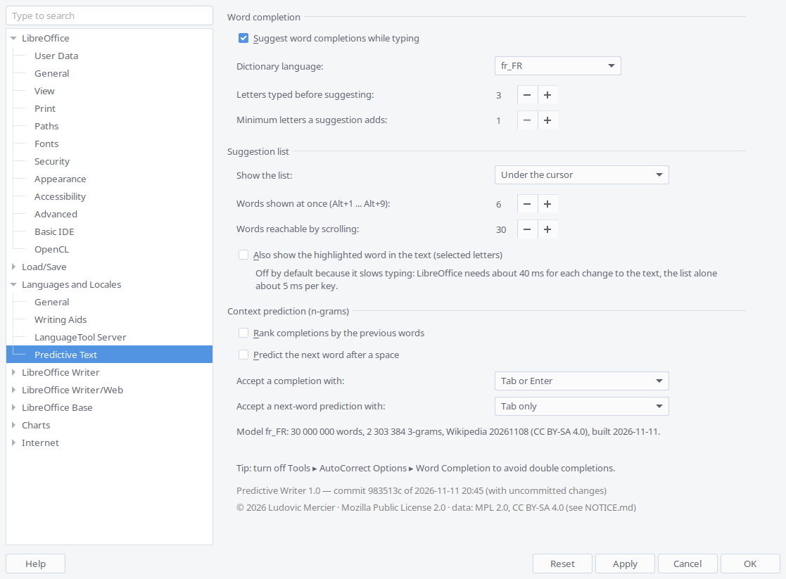

# Predictive Writer

Predictive word completion for LibreOffice Writer, backed by Hunspell dictionaries.
To build it, see [Build](#build); to install it, see [Installation](#installation).


Writing a letter by Anatole France:

https://github.com/user-attachments/assets/9496e424-ec04-4483-b57f-5fda7c5552b1

*Text: opening of Anatole France's letter to Marcel Cachin, « On croit mourir pour la
patrie, on meurt pour des industriels », published in* L'Humanité *on 18 July 1922
(public domain). Typed with context prediction on (Wikipedia model): 836 characters in
635 keystrokes, 24% fewer.*

## Status: suggestion list + context prediction + French grammar

While you type, a numbered list of the most likely words appears under the cursor:
6 at a time, and you can scroll through up to 30 (both adjustable). Optionally, the
highlighted word is also shown in the text as selected letters: `prédi[re]` (off by
default, see below).

```
La prédi|
     ┌─────────────┐
     │ 1 prédire   │  ← highlighted
     │ 2 prédicat  │
     │ 3 prédicant │
     │ …           │
     │   1–6 / 30  │  ← shown when there are more words than fit
     └─────────────┘
```

| Key | Effect while suggestions are shown |
| --- | --- |
| Tab / Enter | accept the highlighted word (the cursor jumps after it); configurable, see Settings |
| ↑ / ↓ | move the highlight; past the last visible word the list scrolls (wraps around at the end) |
| Page Up / Page Down | move one page (stops at the first / last word) |
| Alt+1 … Alt+9 | pick the word with that number in the visible part of the list |
| click on a word | pick it |
| Esc | close the list (and remove the selected letters) |
| Backspace / Delete | close the list; with letters shown in the text, remove only them |
| any other key | closes the list, then works normally |

When no suggestion is shown, all keys (Tab in tables, Enter, arrows...) behave as usual.
Clicking elsewhere or saving also closes the list. Rejected suggestions leave no trace in
the Undo list; an accepted one is its own Undo step.

The list can also be a bar at the bottom or top of the text area (see Settings).

- Suggestions start after 3 letters (adjustable) and are ranked by how common the word
  is in everyday French (film subtitles): `com` → comme, comment, combien.
- **Verbs agree with the subject**: `nous mang` → mangeons, `tu mang` → manges,
  `j'ai mang` / `elle est arriv` → past participle (mangé, arrivée), `il faut mang` /
  `je vais fai` → infinitive. Object pronouns and *ne*/*pas* in between are skipped
  (`je ne l'ai pas mang` → mangé). Noun subjects (`les enfants mang`) are not handled.
- **Right after an apostrophe**, suggestions appear at once and only offer words that
  may follow it: `j'` → j'ai, j'étais, j'avais; `qu'` → qu'il, qu'elle; `je l'` →
  l'ai, l'aime (never `l'arbres` or `l'chat`).
- The apostrophe style (`'` or `’`) and capitals (`J’`, `L’`) follow your text.
- Turn it on or off in **Tools → Options → Languages and Locales → Predictive Text**.

### Before using

Turn off Writer's built-in Word Completion (**Tools → AutoCorrect Options → Word
Completion → Enable word completion**), otherwise both complete at once.

### Settings

**Tools → Options → Languages and Locales → Predictive Text**:



The bottom of the page shows the version and the git commit the extension was built from.

| Setting | Default |
| --- | --- |
| Suggest word completions while typing | on |
| Dictionary language (`fr_FR`, `en_US`) | `fr_FR` |
| Letters typed before suggesting | 3 |
| Minimum letters a suggestion adds | 1 (so `je mang` offers *mange*) |
| Show the list: under the cursor, bar at the bottom, bar at the top, don't show | under the cursor |
| Words shown at once (1–9) | 6 |
| Words reachable by scrolling (1–100) | 30 |
| Also show the highlighted word in the text (selected letters) | off (slower, see below) |
| Rank completions by the previous words (n-gram model) | off |
| Predict the next word after a space (n-gram model) | off |
| Accept a completion with: Tab or Enter, Tab only, Enter only | Tab or Enter |
| Accept a next-word prediction with: same choices | Tab only (Enter keeps making a new paragraph) |

Changes apply as soon as you press OK or Apply, without restarting. Automatic
language detection from the text comes in the futur.

The settings are stored in `~/.config/libreoffice/4/user/predictive-writer/settings.json`.
If you edit that file by hand, restart LibreOffice.

**Troubleshooting log:** `"debug": true` in `settings.json` (not on the Options page) logs
every keystroke and suggestion to `log.txt` in the same folder. The log then contains what
you type; it never leaves your machine. Set it back to `false` when you are done.

### Context prediction (n-grams)

With an n-gram model, suggestions take the previous words into account:
`la seconde guerre mon` → *mondiale*, `les états u` → *unis*, and after a space the
list offers the next word: `il a été ` → *réalisé, découvert, créé…*,
`la ville de ` → *Paris, Toulouse…* It uses [pressagio](https://github.com/Poio-NLP/pressagio)
(vendored, Apache-2.0), runs in a background thread, and the dictionary list is shown
first and replaced when the context predictions arrive.

The model is not shipped with the extension: build it once on your machine.

```bash
# French Wikipedia, 30 million words: ~236 MB downloaded, ~5 min, 314 MB model
python3 tools/train_ngrams.py --wikipedia
# Smaller / quicker, or with your own documents too:
python3 tools/train_ngrams.py --wikipedia --max-words 5000000
python3 tools/train_ngrams.py --wikipedia --folder ~/Documents
```

The Wikipedia dump is read over HTTPS in slices (range requests), never stored whole:
`--slice-mb` (default 25), `--max-slices` (default 10 per dump file, i.e. at most
250 MB) and `--pause` between slices (default 2 s). Reading stops at `--max-words`
(default 30 million) or after the last slice, whichever comes first.

It writes `~/.config/libreoffice/4/user/predictive-writer/ngrams_fr_FR.sqlite`. Then tick
the context options in the Options page (restart LibreOffice after rebuilding a model).

**Licence of a Wikipedia model:** Wikipedia text is CC BY-SA 4.0 (and GFDL). A model built
from it is for your own use; if you share it, keep it under CC BY-SA 4.0 with the
attribution recorded in its `_meta` table (source, dump date, licence).

### Known limitations

- **Speed of the letters shown in the text:** LibreOffice needs 15–60 ms for each change
  the extension makes to the text, so showing the highlighted word in the text adds
  about 40 ms when it appears and 20 ms when it goes, and ↑/↓ cost about 40 ms each.
  The list alone costs about 5 ms per key. That is why "Also show the highlighted word
  in the text" is off by default.
- **Scrolling the list is keyboard only:** LibreOffice's window API has no
  mouse-wheel event for the list.
- **The list does not follow scrolling:** if you scroll with the mouse wheel while the
  list is open, it stays where it was until the next key.
- **The list uses LibreOffice's accessibility interface** to find the cursor on screen
  (the text API does not expose it). It is clipped to the document area.
- **Startup:** the French list (450k word forms with their grammar data) loads in the
  background in about 4–6 s and uses about 26 MB of memory. There are no suggestions
  until it has loaded.
- **Verb agreement** relies on subject pronouns, avoir/être and a list of modal verbs
  and prepositions; noun subjects (`les enfants mang`) are not handled. Rare dialectal
  forms (`mangeotter`) may appear at the end of a list.
- **Dead keys / IME:** a character composed with a dead key (`^` + `e`) may not trigger
  a suggestion until the next key.

## Build

Building the extension only needs **Python 3.8+** (and `git`, for the build
information); LibreOffice is not needed. The word lists in `extension/data/` are
already generated and committed.

```bash
python3 tools/build_oxt.py                     # -> dist/predictive-writer-<version>.oxt
```

To try a build on your own machine (see [Installation](#installation)):

```bash
unopkg add -f dist/predictive-writer-1.0.oxt   # close LibreOffice first
soffice --writer                               # start from a terminal to see errors
```

### Version

The version (major.minor) is set in two places that must agree, checked by
`build_oxt.py` and by the tests: `extension/description.xml` (`<version value="1.0"/>`,
shown by LibreOffice) and `extension/python/pythonpath/predictive/__init__.py`
(`__version__`). Installing a newer `.oxt` with `unopkg add -f` replaces the old one.

`build_oxt.py` also stores the last git commit (short hash and date, and whether there
were uncommitted changes) inside the `.oxt`; the bottom of the Options page shows it,
e.g. *Predictive Writer 1.0 — commit 04ab2b9 of 2026-11-11 20:35*.

### Automatic build on GitHub

The workflow [.github/workflows/build.yml](.github/workflows/build.yml) runs on every
push and pull request: tests (Python 3.8 and 3.13), lint (`black`, `pyflakes`), then
the build. The `.oxt` can be downloaded from the run's page (**Actions** tab,
*Artifacts*).

To publish a release, push a tag `v<version>` matching `description.xml`; the workflow
checks it and creates a GitHub Release with the `.oxt` attached:

```bash
git tag v1.0
git push origin v1.0
```

### Word lists

Only needed to regenerate `extension/data/`:

```bash
python3 tools/build_wordlist.py --lang en_US
python3 tools/build_wordlist.py --lang fr_FR \
    --freq sources/frequencywords/fr_full.txt \
    --elision-model ~/.config/libreoffice/4/user/predictive-writer/ngrams_fr_FR.sqlite
```

`tools/build_wordlist.py` expands `/usr/share/hunspell/<lang>.dic/.aff` into all word
forms (conjugations, plurals...) with its own affix expander (no extra dependency),
keeping Hunspell's grammar tags (person, infinitive, participle) and accepted
elisions. `--freq` takes a `word count` list (here *FrequencyWords*, OpenSubtitles);
`--elision-model` scores elided pairs (`l'année`) with the n-gram model and writes
`fr_FR.elisions.tsv`.

Third-party data and their licences (MPL 2.0, CC BY-SA 4.0...) are listed in
[extension/NOTICE.md](extension/NOTICE.md).

## Installation

On any computer, from the packaged extension `predictive-writer-<version>.oxt`, built
with [Build](#build) or downloaded from the
[Releases page](https://github.com/lidiriel/predictwriter/releases)
(about 2 MB; current version: **1.0**, shown in **Tools → Extension Manager**).

### Prerequisites

| | Debian / Ubuntu | Other systems |
| --- | --- | --- |
| LibreOffice | 7.0 or later (tested with 25.2 on Debian 13) | same |
| Python support in LibreOffice | `sudo apt install python3-uno` — **not installed automatically** with `libreoffice-writer`; without it the extension does not start | Fedora: `libreoffice-pyuno`; Windows / macOS: included with LibreOffice (untested) |

Nothing else: the word lists (French and English, with frequencies and grammar data)
and pressagio are inside the `.oxt` — no Hunspell, no `pip` package.

### Steps

1. Copy `predictive-writer-1.0.oxt` to the computer.
2. Close LibreOffice, then install the extension:
   ```bash
   unopkg add predictive-writer-1.0.oxt
   ```
   or, in LibreOffice, **Tools → Extension Manager → Add…**
3. Start Writer and turn off the built-in completion: **Tools → AutoCorrect Options →
   Word Completion → Enable word completion** (untick).
4. Adjust **Tools → Options → Languages and Locales → Predictive Text** if needed
   (settings are per user profile: a new computer starts with the defaults).

> **Conda users:** run `unopkg` and `soffice` from a shell with conda **deactivated**
> (`conda deactivate`, or `env -u CONDA_PREFIX PATH=/usr/bin:/bin unopkg ...`).
> With a conda environment active, registering the Python component fails with
> `std::bad_alloc`. This also applies when you start LibreOffice from that shell.

### Optional: context prediction model

Context ranking and next-word prediction need the n-gram model (about 314 MB), which is
not in the `.oxt`. Either copy an existing `ngrams_fr_FR.sqlite` into the profile folder:

| System | Location |
| --- | --- |
| Linux | `~/.config/libreoffice/4/user/predictive-writer/ngrams_fr_FR.sqlite` |
| Windows | `%APPDATA%\LibreOffice\4\user\predictive-writer\ngrams_fr_FR.sqlite` |
| macOS | `~/Library/Application Support/LibreOffice/4/user/predictive-writer/ngrams_fr_FR.sqlite` |

or rebuild it on that computer (needs this project folder, Python 3 and internet access;
about 236 MB downloaded, about 5 minutes):

```bash
python3 tools/train_ngrams.py --wikipedia               # Linux: written to the folder above
python3 tools/train_ngrams.py --wikipedia --out <path>  # Windows / macOS: give the path
```

Then tick **Rank completions by the previous words** and **Predict the next word after a
space** in the Options page (restart LibreOffice if Writer was already open).

### Checking that it works

`log.txt`, in the same `predictive-writer` folder, should contain after opening Writer:

- `Predictive Writer 1.0 — commit … starting` (the version and the commit it was built from)
- `loaded fr_FR: 449932 words` a few seconds later
- `context prediction: using …` if the model is in place and the options are ticked

### Uninstall

```bash
unopkg remove net.scilink.predictivewriter
```

The `predictive-writer` folder of the profile (settings, log, model) can then be deleted.

## Tests

```bash
python3 -m pytest tests/        # needs pytest; no LibreOffice required
```

`tests/test_french_real.py` checks the behaviour on the real French data (frequency
order, verb agreement, elisions) and is skipped if `extension/data/` is missing.

## Licence

Predictive Writer is © 2026 Ludovic Mercier, under the
[Mozilla Public License 2.0](LICENSE) (the same licence as LibreOffice and the French
Dicollecte dictionary). The `.oxt` includes this `LICENSE` file.

Bundled third-party code and data keep their own licences — pressagio (Apache 2.0), word
lists derived from Hunspell dictionaries (MPL 2.0 / SCOWL), word frequencies from
OpenSubtitles and elision scores from Wikipedia (CC BY-SA 4.0) — see
[extension/NOTICE.md](extension/NOTICE.md). An n-gram model you build from Wikipedia is
CC BY-SA 4.0 too (see Context prediction).
